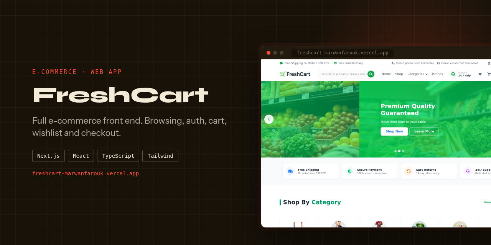

[](https://freshcart-marwanfarouk.vercel.app/)

# 🛒 FreshCart

A full e-commerce front end built with Next.js, React and TypeScript. Browse products, manage a cart and wishlist, and work through authentication and checkout flows.

## Demo

[Open the live demo](https://freshcart-marwanfarouk.vercel.app/)


## What it includes

- Product lists, categories, brands and product detail pages.
- Sign up, sign in and a multi-step password reset flow.
- Cart quantity updates, item removal and a wishlist, backed by a hosted e-commerce API.
- Checkout forms, cash-order and online checkout-session requests, and an orders page.
- TanStack Query for cart and wishlist queries and mutations, with success/error notifications.
- React Hook Form and Zod for form validation, plus responsive product grids.

### Stack

Next.js 16 (App Router) · React 19 · TypeScript · Tailwind CSS 4 · TanStack Query 5 · Zustand · React Hook Form · Zod · Axios

### Code layout

- `src/app/`: routes and layouts.
- `src/features/`: product, auth, cart, wishlist, checkout and order modules.
- `src/components/shared/`: shared navigation, footer and loading UI.
- `src/providers/`: shared providers, including the query client.
- `src/store/`, `src/styles/`, `src/types/`, `src/assets/`: global store, global styles, shared types and static assets.

## Run locally

Use Node.js 20.9 or newer.

```bash
git clone https://github.com/MarwanXFarouk/FreshCart.git
cd FreshCart
npm install
npm run dev
```

Open [http://localhost:3000](http://localhost:3000).

Other commands:

```bash
npm run lint
npm run build
npm start
```

`npm start` serves a production build after `npm run build`.

## Notes

- This is a demo project, not a production store.
- Product, authentication, cart and checkout flows depend on an external e-commerce API. Sign in to use account-specific features.
- Checkout code is included, but the demo is not a promise of real payment processing or order fulfillment. Do not enter real payment details to try it.
- The screenshot is cropped to leave out the demo's contact strip.

Built by [Marwan Farouk](https://github.com/MarwanXFarouk) · [LinkedIn](https://www.linkedin.com/in/marwanfarouk/)
